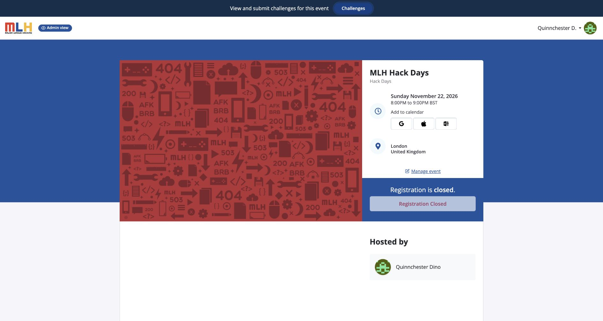
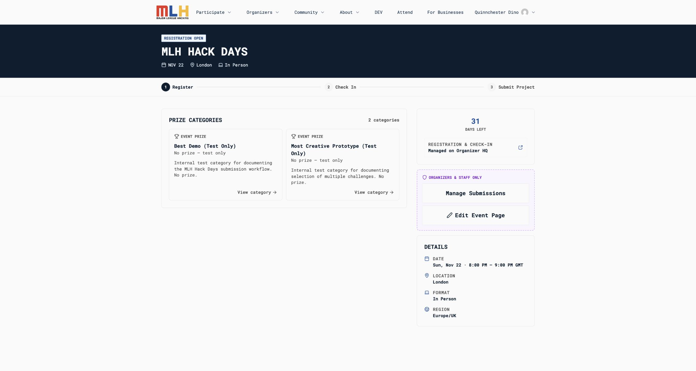
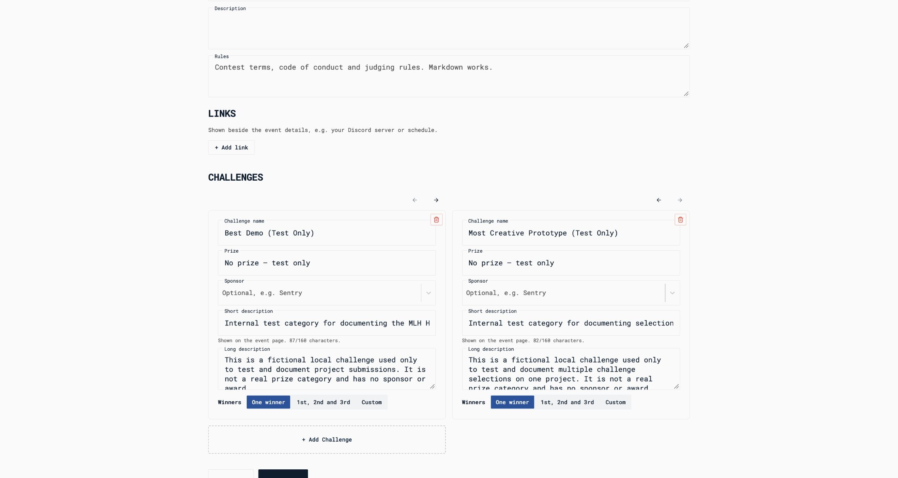
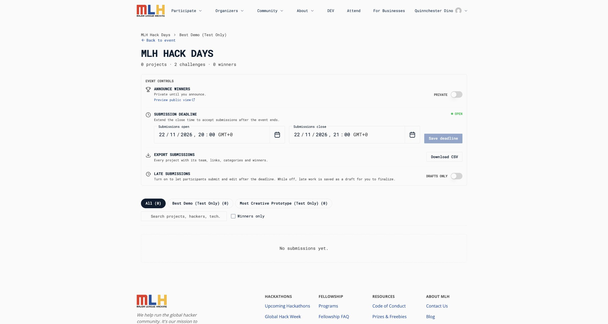

# Project Submissions and Judging

*Last updated: October 2026.*

Every presenting project must be submitted through the event's **Challenges** page. Teams must also select each eligible partner challenge they are entering. Devpost, a form, or another platform does not replace this flow.

## Find the Challenges Page and Organizer Controls

1. Once the event is published in OrganizerHQ, open its OrganizerHQ event page while signed in as an organizer. The **Challenges** link appears in the banner at the top. Draft events do not have this attendee-facing link.
2. Select **Challenges** to open the event on MLH.com.
3. In the **Organizers & staff only** panel on the MLH.com event page, select **Manage Submissions**. This opens the project submission and judging controls. It is separate from **Registrations** in OrganizerHQ.

<figure><figcaption>
The Challenges link appears on the published OrganizerHQ event page.
</figcaption></figure>

<figure><figcaption>
Use Manage Submissions on the MLH.com event page for projects, exports, and judging.
</figcaption></figure>

The banner can appear before challenge categories have been assigned. Confirm that the expected categories are visible on the MLH.com event page before asking teams to choose them.

## Add Local Challenges

On the MLH.com event page, select **Edit Event Page** in the **Organizers & staff only** panel. Scroll to **Challenges** and select **+ Add Challenge** for each local category. Enter its **Challenge name**, **Prize**, optional **Sponsor**, **Short description** (shown on the event page), and **Long description**. Choose whether the category has **One winner**, **1st, 2nd and 3rd**, or **Custom** winner places. Check the category order and select **Publish** to save the event page. Reopen the public event page and verify each category and its description before sharing the submission link.

<figure><figcaption>
The Challenges editor on a published test event, with two explicitly marked test categories.
</figcaption></figure>

Only attach a sponsor to a challenge that the partner actually supports. Set the prize and winner places to the event's real plan before publication.

## Set the Submission Window

An organizer controls when teams can submit:

1. Open **Manage Submissions** using the route above.
2. Under **Submission Deadline**, set the **Submissions open** and **Submissions close** date and time.
3. Select **Save deadline**.
4. Confirm that the saved open and close times match the window you intend to give teams.

At the scheduled opening time, check the attendee challenge page and confirm that an eligible team member can select **Submit a Project**. If that control is unavailable, check the saved times and the attendee's registration or check-in status before directing teams to submit.

Set **Submissions open** for build time and **Submissions close** for the project deadline, before demos begin. These date controls schedule the window; there is no separate manual opening step on this page. You can move the opening time earlier and save it if needed, then verify attendee access. If the deadline changes, update the closing time and tell every team. The separate **Accept late submissions** switch lets participants submit or edit after the deadline. While it is off, late work is saved as a draft for an organizer to finalize.

<figure><figcaption>
Manage Submissions brings the deadline, export, project list, and winner controls together.
</figcaption></figure>

## Before Building Begins

Tell hackers:

* The exact submission deadline
* Which partner and local challenges are available
* The required project information
* The demo format and time limit
* The judging criteria
* That every presenting project must be submitted, even if it is not entering a partner challenge

Open the **Challenges** page yourself and confirm that every challenge assigned by MLH appears correctly. Do a real attendee-path check with a registered, checked-in test account when the event and submission window are active. Do not infer that a saved deadline alone makes the submission form available.

Use the [MLH Standard Hackathon Rules](https://github.com/MLH/mlh-policies/blob/main/standard-hackathon-rules.md) as the default: project-specific work happens during the Hack Day. Organizers may use a different approach when it suits their event, but must communicate it clearly before building begins.

## How Teams Submit Projects

One team member should submit the project on behalf of the team:

1. Sign in using the account used to register for the event, and complete event check-in when required.
2. Select **Challenges** in the “View and submit challenges for this event” banner.
3. On the MLH.com event page, select **Submit a Project** when the button is enabled.
4. Enter the project link, project name, description, and technologies used.
5. Add a demo URL if the team has one.
6. Under **Which challenge(s) are you submitting to?**, select every partner and local challenge the project is eligible to enter.
7. Select **Submit Project** before the deadline.


The same project can appear once for every challenge it selected, and the total shown in Manage Submissions may count those challenge entries. This is expected; do not treat them as duplicate project forms.


## Verify Every Project Before Demos

Return to **Manage Submissions** before demos begin:

1. Identify each unique project in the **All** view and compare it with the teams scheduled to present. Do not rely on the headline total when projects entered more than one challenge.
2. Use the challenge tabs to confirm that each assigned partner category has the expected entries.
3. Search by project, hacker, or technology when you need to find a specific submission.
4. Ask a missing team to submit while the window remains open. Apply the same deadline policy to every team.
5. Confirm that the submission window is closed when demos begin, then refresh the list.

## Download the Project Submissions CSV

In **Manage Submissions**, find **Export Submissions** below **Submission Deadline** and select **Download CSV**. This exports project submissions; the registration export in OrganizerHQ is a different list. Open the downloaded CSV to check that it reflects the projects you expect, and download a fresh copy after any late submissions or changes.

## Use a Simple Judging Rubric

Score every eligible project using the same criteria. A lightweight rubric works well for short events:

| Criterion | What judges should consider |
| --- | --- |
| Technical implementation | Does the project work, and how effectively does it use the chosen technology? |
| Creativity | Is the idea or implementation distinctive? |
| Learning and ambition | What did the team learn or attempt during the Hack Day? |
| Demo and clarity | Can the team clearly explain the problem, solution, and implementation? |
| Partner eligibility | Does the project satisfy the assigned partner's specific requirements? |

Tell judges how to handle ties before judging starts. A judge should disclose a close relationship with a team and recuse themselves when that relationship could affect the result.

## Select Proposed Winners

Use the same **Manage Submissions** page to review entries before marking winners. For each MLH partner category:

1. Filter Manage Submissions to the relevant challenge.
2. Confirm that the project appears under that challenge.
3. Verify the partner-specific evidence described on the relevant partner page.
4. Select the strongest eligible project using the published rubric.
5. Record the proposed result in the judges' notes.

Do not announce a winner yet. Continue to [Closing Ceremony and Winner Declaration](event-planning-guide/closing-ceremony-and-winner-declaration.md) to mark each winner, verify the saved result, and make the project gallery public.
